# Mon Cher Barre


### [ 나를 아는 발레 연습 AI 비서]  
 
<br>

> 일반적인 LLM은 내 연습 기록도, 내가 어제 다친 발목도, 내가 만든 루틴 음악도 모릅니다.  
> **Mon Cher Barre**는 365일 연습 기록·대화·즐겨찾기·조회한 용어를 기억하고, 그날의 상태에 맞는 루틴과 동작을 표와 영상 링크로 추천하는 **개인 AI 비서**입니다.  
> 평소 **iPad** 연습 시 기준으로 설계했고 홈 화면에 추가하여 앱처럼 사용합니다.

---
<br>


## Introduction

| 무엇을 해결하나 | 어떻게 |
|:---|:---|
| 발레 연습을 꾸준히 **기록**하고 추세를 보고 싶다 | 연습 기록 CRUD(추가·수정·삭제) + 기간 선택 통계 그래프 + CSV/JSON 내보내기 |
| 오늘 수업·날씨·**아픈 부위**에 맞춰 바로 **질문**하고 싶다 | 데이터 요약을 주입한 AI 채팅 + Function Calling 도구 7개 |
| 내가 만든 **10/20/30/60분 루틴과 음악**을 그대로 쓰며 추천받고 싶다 | 루틴 버튼 → 재생기(음악)와 채팅 추천이 같은 곡·같은 시간·같은 동작 목록으로 연결 |
| 모르는 **발레 용어**를 소리·영상으로 확인하고 싶다 | 96개 용어 사전(한글 설명·IPA·프랑스어 발음 mp3·로열발레 영상) + 의미 기반 검색 |
| **나를 기억하는** 비서였으면 좋겠다 | 비서 메모 문서 1개에 상태·대화 요지·자주 찾은 용어·본 영상·주로 한 루틴을 누적, 다음 대화에 반영 |

- **iPad 우선**: 가로 화면모드에서, 왼쪽(대표 사진·루틴 재생기)과 오른쪽(채팅)이 **각각 스크롤**, 세로 화면 모드는 입력창을 화면 아래에 고정. 터치·홈 화면 앱·잠금 화면 음악 컨트롤을 지원합니다.
- **무료 한도 안에서 운영**: Firestore 무료 읽기 한도(하루 5만 건)를 넘지 않도록 읽기를 최소화 설계 ([설계](#-firestore-읽기-절감-설계))  

---
<br>

## Tech Stack

| 계층 | 사용 기술 | 설명 |
|:---|:---|:---|
| **Frontend** | HTML5, CSS3, Vanilla JavaScript, Chart.js | 프레임워크 없는 단일 페이지(탭 5개), 유동 레이아웃, PWA(홈 화면 앱), Web Audio, Media Session, History API |
| **Backend** | Python 3.12, FastAPI, uvicorn, Pydantic | 라우터/서비스/스키마 분리, CORS, Swagger |
| **AI** | OpenAI Chat Completions(`gpt-5-mini`, `reasoning_effort=low`) + Function Calling | 도구 7개, 최대 6회 반복 |
| **Embedding** | `text-embedding-3-small` (1536차원) | 용어 96개 색인을 파일로 보관해 Firestore 읽기 0건 |
| **Database** | Firebase Firestore | `data`·`conversations`·`favorites`·`symptom_map`·`class_schedule`·`routine_templates`·`meta`·`assistant` |
| **외부 채널** | MCP Server 2.2.0 (stdio) → Claude Desktop | 같은 도구를 외부 클라이언트에서 호출 |
| **외부 API** | Open-Meteo (대체 wttr.in) | 키 불필요, 서울 날씨(비·눈·강수확률 포함) |
| **Deploy** | Render(백엔드) + Vercel(프론트엔드) | 무료 플랜 |

---
<br>

## Deployment URLs

| 구분 | 주소 |
|:---|:---|
| **프론트엔드 (Vercel)** | https://mon-cher-barre.vercel.app |
| **백엔드 API (Render)** | https://moncherbarre.onrender.com |
| **Swagger UI** | https://moncherbarre.onrender.com/docs |
| **ReDoc** | https://moncherbarre.onrender.com/redoc |
| **헬스 체크** | https://moncherbarre.onrender.com/health |
| **GitHub** | https://github.com/OZ-Codessey/MonCherBarre |

> ⏳ Render 무료 플랜은 한동안 요청이 없으면 잠들어 **첫 요청이 최대 1분 걸릴 수 있습니다.** 앱은 5초 넘게 응답이 없으면 화면에 안내 문구를 보여 줍니다.

---
<br>

## 📸 Records.. 

### 1. 데이터 요약이 보이는 채팅 화면 (질문 + 답변)
> 왼쪽 아래 **데이터 요약 카드**(기간·개수·평균·추세)와 오른쪽 질문·답변 표/요약. 답변을 기다리는 동안에는 로딩 표시가 나옵니다.

| 질문 + 답변 (iPad 가로) | 로딩 표시 |
|:---:|:---:|
| 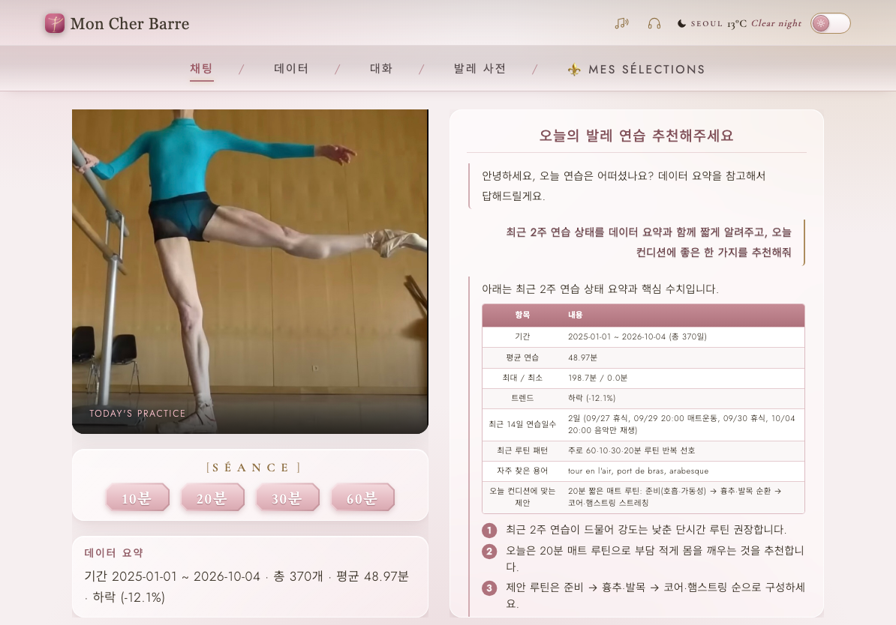 | 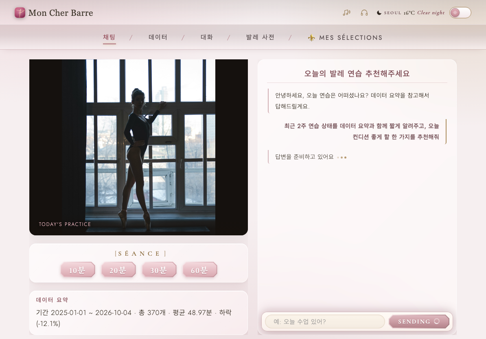 |

### 2. 데이터 관리 화면 (CRUD 중 수정)
> 기록 추가 카드 · 검색/필터 카드 · 기록 목록(7개 표시, 접기) · **수정 폼이 열린 모습**

| 목록 + 추가 + 검색/필터 | 수정 폼 |
|:---:|:---:|
| 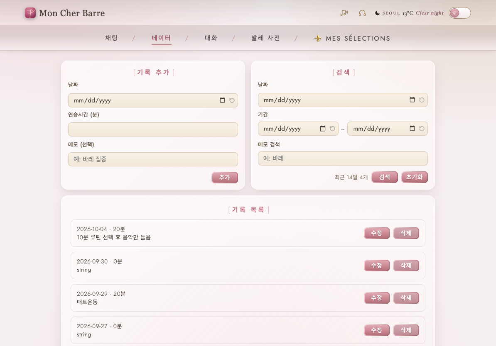 | 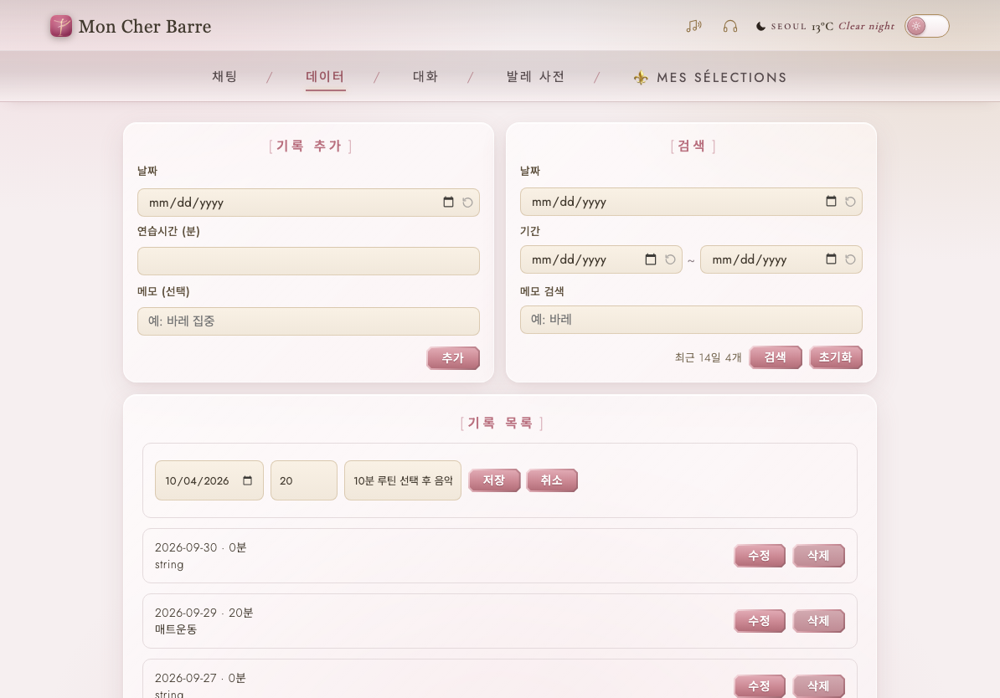 |

### 3. 대화 기록 화면 (불러오기)
| 최근 7일 대화 목록 | 불러오기 후 메시지 재표시 |
|:---:|:---:|
| 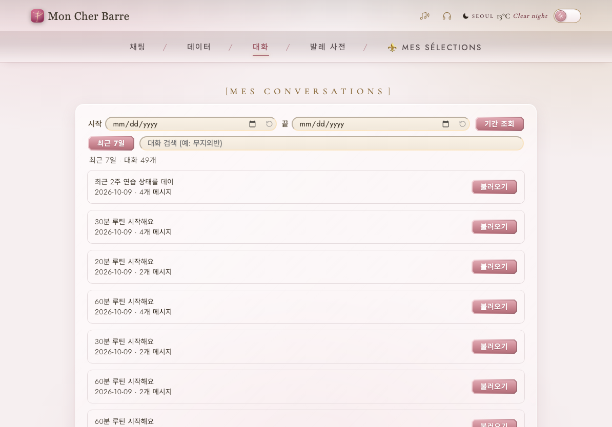 | 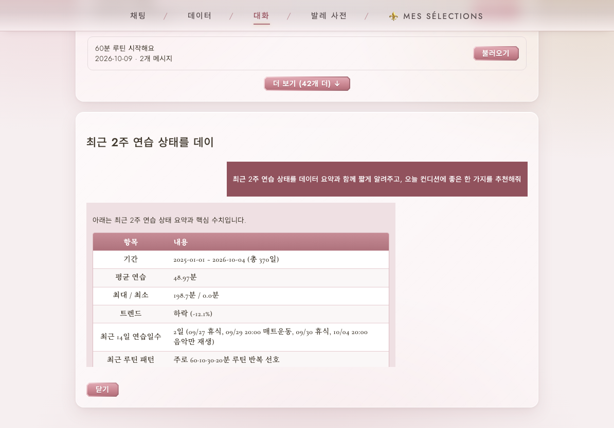 |

### 4. 그 밖의 화면
| 첫 화면 (대표 사진 + 루틴 버튼) |
|:---:|
| 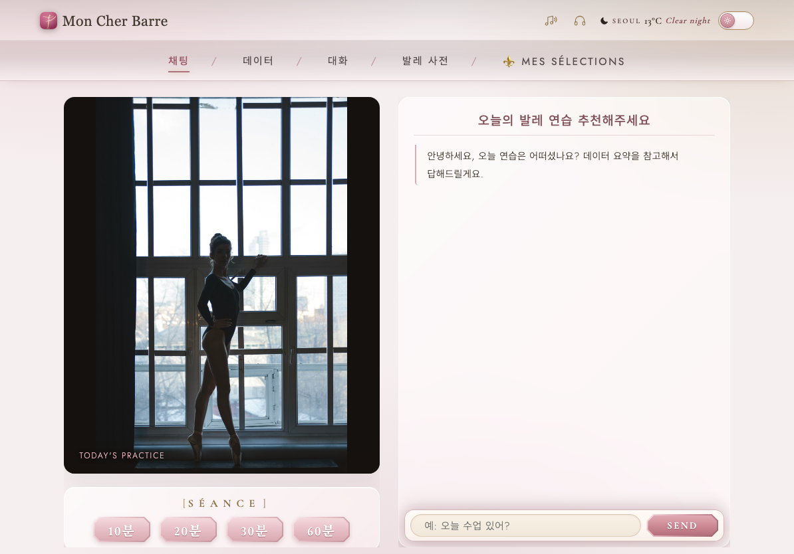 |

| 루틴 버튼 → 재생기 + 같은 곡 표 | 기간 통계 분석 |
|:---:|:---:|
| 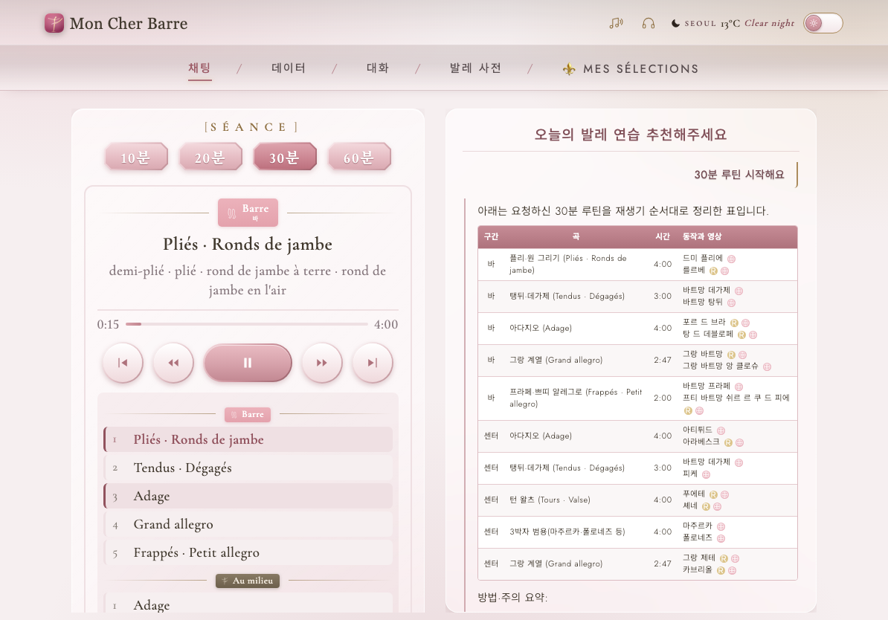 | 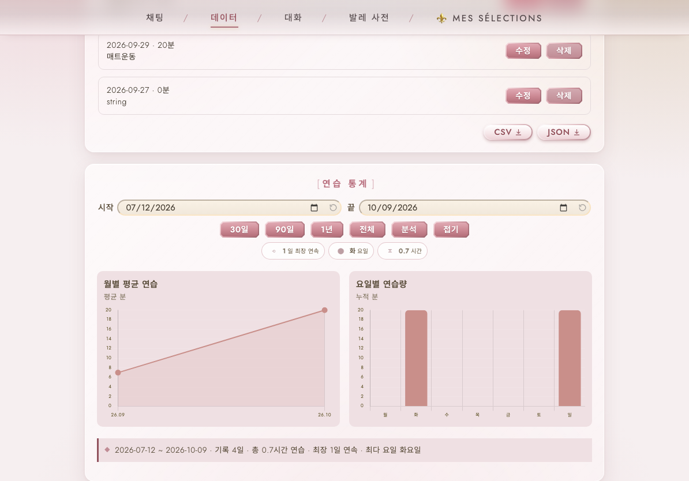 |

| 발레 사전 (용어 상세·영상) | 즐겨찾기 |
|:---:|:---:|
| 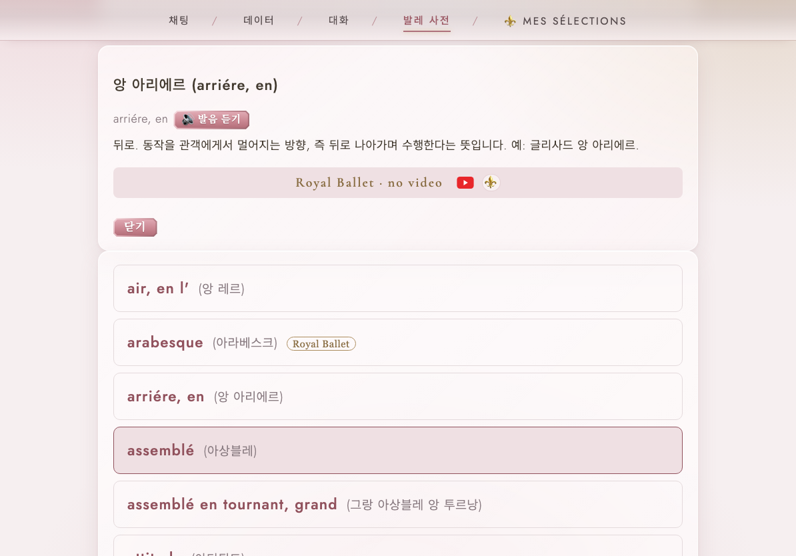 | 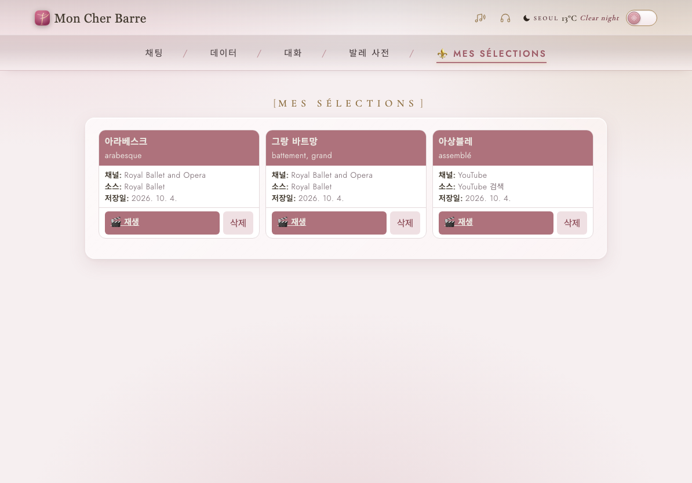 |

| 다크 모드 | iPad 세로 |
|:---:|:---:|
| 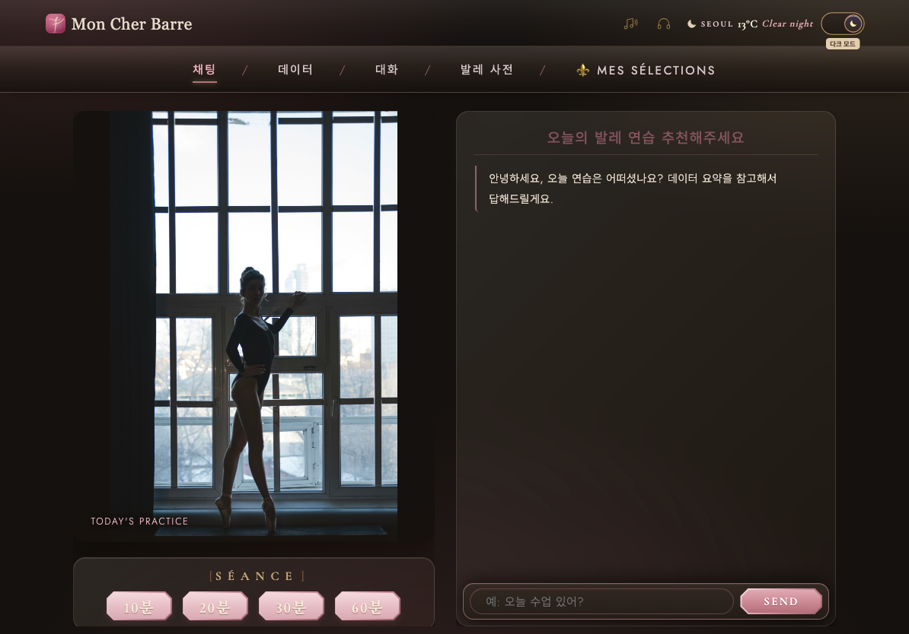 | 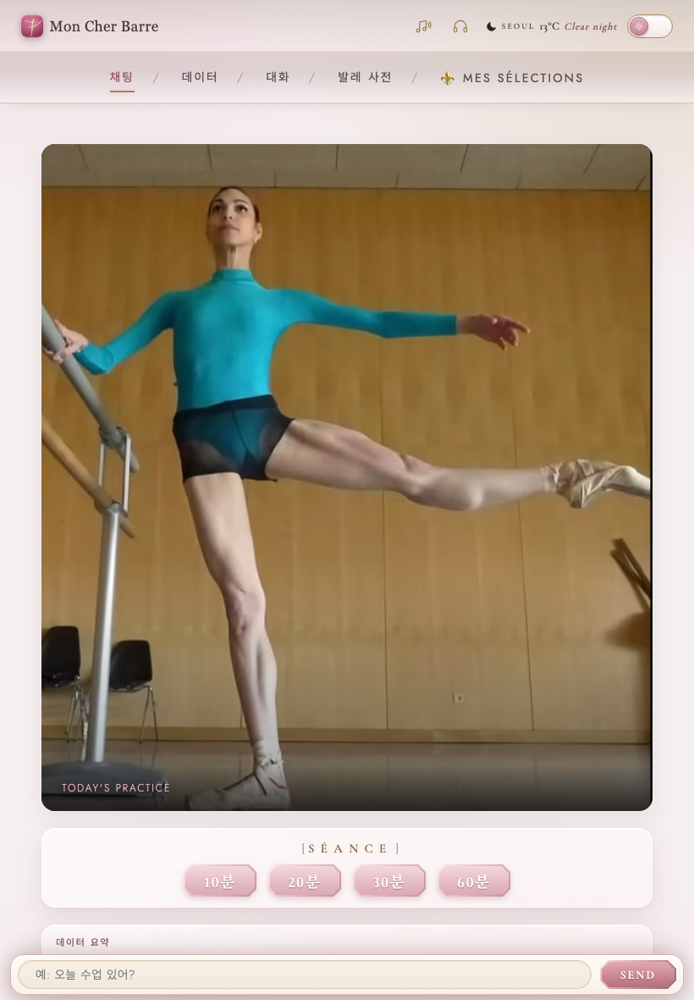 |

| 날씨 칩 툴팁(비·눈·강수확률) | Swagger UI | Swagger 실행 결과 |
|:---:|:---:|:---:|
|  | 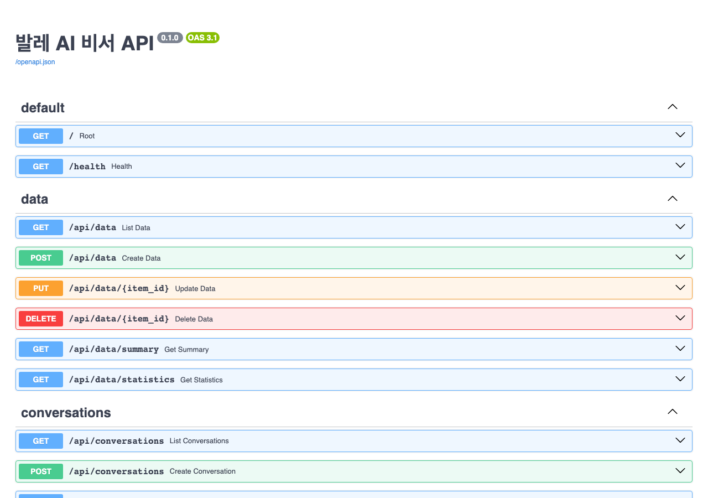 | 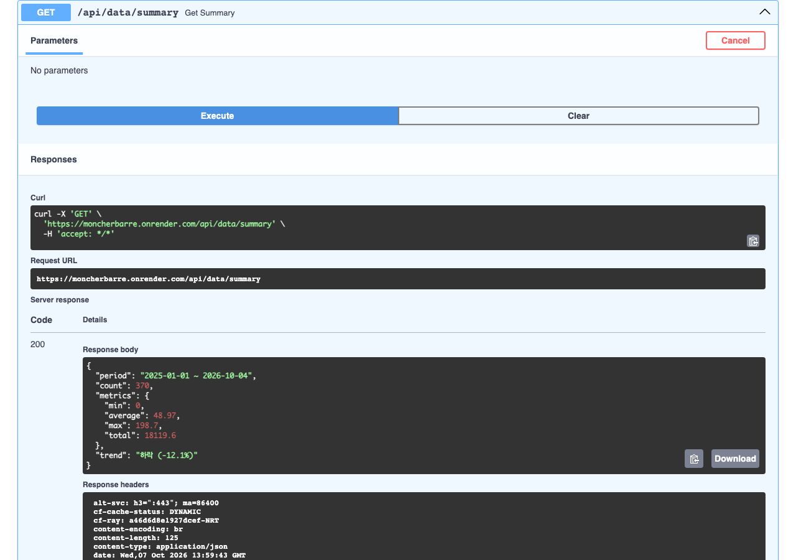 |

---
<br>

## Architecture

```
┌─────────────────────────────────────────────────────────────────┐
│                     Frontend (Vercel, 정적)                      │
│  index.html · css/style.css · js/app.js · Chart.js              │
│  채팅 · 데이터 관리 · 대화 · 발레 사전 · 즐겨찾기                │
│  루틴 재생기(음악) · 날씨 칩 · 다크 모드 · PWA                   │
│  ▸ 읽어 온 기간을 브라우저에 쌓아 두고, 안 읽은 기간만 요청      │
└───────────────────────────────┬─────────────────────────────────┘
                                │ HTTPS (CORS: ALLOWED_ORIGINS)
┌───────────────────────────────▼─────────────────────────────────┐
│                     Backend (Render, FastAPI)                    │
│  routers: data · conversations · chat · moves                   │
│  services: data · conversation · chat · memory · rag_tools      │
│                                                                 │
│  ┌──────────────┐   ┌──────────────────────────────────────┐    │
│  │  Firestore   │◄──│ rag_tools.py  (도구 구현은 이 한 곳)   │    │
│  │ data/summary │   │ get_class_schedule  get_seoul_weather│    │
│  │ conversations│   │ get_moves_by_symptom search_term_by_ │    │
│  │ assistant    │   │ meaning  get_routine  get_move_links │    │
│  └──────────────┘   └───────▲───────────────────▲──────────┘    │
│                             │ Function Calling  │ MCP (stdio)   │
│                    chat_service.py        mcp_server.py         │
│  파일(읽기 0): moves_96.json · routines.json · music_mapping.json│
│                exercises.json · moves_embeddings.json           │
└─────────────────────────────┼───────────────────┼───────────────┘
                              ▼                   ▼
                       OpenAI (gpt-5-mini)   Claude Desktop (로컬)
```

**핵심:** 도구는 `rag_tools.py` **한 곳에만 구현**하고, 앱 안의 GPT(Function Calling)와 밖의 Claude Desktop(MCP)이 **같은 함수**를 부릅니다. 그래서 두 채널의 결과가 항상 같습니다.

### 컨텍스트 주입 (미션 4-7)

```
POST /api/chat  { "message": "10분 루틴 시작해요" }
   │
   ├─ 1. 요약 조회      meta/summary 문서 1장 (기간·개수·평균/최대/최소·추세)
   ├─ 2. 최근 14일      오늘 포함 최근 연습 기록 (읽기 최대 14건, 서버가 보관)
   ├─ 3. 비서 메모      assistant/memory 문서 1장 (상태·대화 요지·자주 찾은 용어 …)
   │       └─ 위 3가지를 **시스템 프롬프트**에 끼워 넣음
   ├─ 4. GPT 호출       도구 7개 스키마 포함, 필요하면 도구 실행 후 재질문 (최대 6회)
   └─ 5. 자동 저장      질문·답변을 conversations에, 새 기억을 assistant/memory에 한 번씩 저장
```

---
<br>

## 🤖 AI 기술 적용 지도 (RAG · Function Calling · MCP)

> 

### A. 기능별 기술 적용 표

| # | 사용자 기능 (화면) | 사용 기술 | 구현 파일·함수 | 데이터 출처 | Firestore 읽기 | 호출 근거 |
|:---:|:---|:---|:---|:---|:---:|:---|
| 1 | 채팅 답변이 내 상황을 반영 (채팅 탭) | **컨텍스트 주입** (규칙 기반 RAG) | `chat_service._build_system_prompt` | `meta/summary`, 최근 14일, `assistant/memory` | 1~2 | 모든 채팅 요청에서 항상 |
| 2 | 루틴 버튼(10/20/30/60분)을 누르면 재생기와 같은 곡·시간으로 추천. **매트=이완·바닥 운동**, 바=바 동작, 센터=전체 | **Function Calling** `get_routine` + 규칙 기반 RAG | `rag_tools.get_routine` → `moves_local.routine_info` | `routines.json`, `music_mapping.json`, `moves_96.json`, **`area_moves.json`**(구간별 동작 규칙), `exercises.json` (파일) | **0** | "N분 루틴 시작해요" → 구성 확인이 필요 |
| 3 | 추천 동작마다 ▶영상 / 🌐검색 링크 | Function Calling `get_move_links` + 규칙 기반 RAG | `rag_tools.get_move_links` | `moves_96.json` (영상 29개, 없으면 유튜브 검색 링크) | **0** | 추천 동작의 영상 링크가 필요 |
| 4 | "발목이 아파요" → 피할 동작 + 강화 운동 표 | Function Calling `get_moves_by_symptom` + 규칙 기반 RAG | `rag_tools.get_moves_by_symptom` → `moves_local.symptom_info` | `symptom_map.json`(피할 동작), `exercises.json`(강화 운동 11개 + 스트레칭 6개, 준비물·시간·방법·주의·영상) | **0** | 통증·부상 언급 |
| 5 | "허리 뒤로 젖히는 동작 이름이 뭐죠?" | Function Calling `search_term_by_meaning` + **벡터 RAG** | `rag_tools.search_term_by_meaning` | `moves_embeddings.json` (96개 × 1536차원 색인) + `moves_96.json` | **0** | 이름 대신 동작을 묘사 |
| 6 | "오늘 수업 있어?" | Function Calling `get_class_schedule` + 규칙 기반 RAG | `rag_tools.get_class_schedule` | Firestore `class_schedule` (서버 6시간 보관) | 0~2 | 수업 일정 질문 |
| 7 | "서울 날씨 알려줘 / 비 와?" | Function Calling `get_seoul_weather` + 외부 날씨 API | `rag_tools.get_seoul_weather` | 브라우저가 받아 둔 값(20분 이내) → Open-Meteo(2회 재시도) → wttr.in | **0** | 실시간 값 필요 |
| 8 | "발목이 뻐근해" 같은 내 상태 기억 | Function Calling `save_note` + **메모리 RAG** | `chat_service` → `memory_service.add_note` | `assistant/memory` | 0~1 | 상태·일정 변경·"기억해줘" 언급 |
| 9 | 자주 찾은 용어·본 영상·즐겨찾기·주로 한 루틴 반영 | **메모리 RAG** (활동 기록 합치기) | `memory_service.merge_activity/note_routine` | 브라우저 활동 + 서버 집계 → `assistant/memory` | 0~1 | 채팅 요청에 함께 전달 |
| 10 | Claude Desktop에서 "서울 날씨 알려줘" | **MCP Server** (stdio) | `app/mcp_server.py` | `rag_tools`와 같은 함수 | 0 | 외부 클라이언트가 도구 목록을 읽고 선택 |
| 11 | 헤더 날씨 칩 | 브라우저가 Open-Meteo 직접 호출 | `js/app.js loadWeather` | Open-Meteo | 0 | — |
| 12 | 발레 사전 탭 검색 | 브라우저에서 JSON 검색 | `js/app.js loadDictionary` | `moves_96.json` | 0 | — |  
<br>


### B. 기술별 요약

| 기술 | 어디에 쓰였나 | 방식 | 왜 이 방식인가 |
|:---|:---|:---|:---|
| **컨텍스트 주입** | 모든 채팅의 시스템 프롬프트 | 요약 문서 + 최근 14일 + 비서 메모를 프롬프트에 삽입 | GPT는 내 데이터를 모르므로 매번 "참고자료"로 먼저 알려 줌 |
| **규칙 기반 RAG** | 루틴 구성(#2), 영상 링크(#3), 증상별 동작·강화 운동(#4), 수업 시간표(#6) | 키(분·증상 id·용어 이름)로 **정확히** 찾아 GPT에 전달 | 부상·시간처럼 **틀리면 안 되는** 정보는 벡터 추정보다 정확한 조회가 안전 |
| **벡터 RAG** | 용어 의미 검색(#5) | 질문을 임베딩 → 96개 색인과 코사인 유사도 → 상위 6개 | 용어가 프랑스어 원어라 키워드로는 못 찾고, 동작 **묘사**로 찾아야 함 |
| **메모리 RAG** | 상태 메모(#8), 활동(#9) | 문서 1개를 채팅마다 읽어 프롬프트에 주입, 답변 후 1번만 저장 | "나를 아는 비서"의 핵심. 대화방을 지워도 기억이 남음 |
| **Function Calling** | 도구 7개 (아래 C) | GPT가 필요할 때 스스로 도구를 골라 호출 → 결과를 받아 최종 답 | 모든 질문에 모든 데이터를 넣으면 느리고 비쌈. 필요한 것만 호출 |
| **MCP** | Claude Desktop 연동 (아래 D) | 같은 도구 4개를 stdio JSON-RPC로 노출 | 앱 밖의 클라이언트에서도 같은 기능을 검증 |  
<br>

### C. Function Calling — 도구 7개와 호출 근거

> 정의: `app/services/tool_schemas.py` (`TOOLS` 스키마 + `DISPATCH` 실행 표) · 실행 루프: `chat_service._call_with_tools` (최대 6회, 마지막 차례는 도구 호출 금지로 최종 답 보장)

| 도구 | 입력 | 어떤 질문일 때 GPT가 고르나 (호출 근거) | 반환 |
|:---|:---|:---|:---|
| `get_class_schedule` | 없음 | "오늘 수업 있어?", "수업 언제야?" — 시간표가 필요 | 요일·시작·끝 |
| `get_seoul_weather` | 없음 | "날씨", "비 와?", "바람 불어?" — 실시간 값이 필요 | 날씨(맑음/비/눈…), 기온, 체감, 풍속, 강수 여부·확률, 최고/최저 |
| `get_moves_by_symptom` | `symptom_id` (ankle/bunion/knee/back_pain) | "발목이 아파요", "허리가 뻐근해" — 통증·부상 언급 | 피할 동작 + 강화 운동(준비물·시간·방법·주의·영상) |
| `search_term_by_meaning` | `text` | "다리를 옆으로 차올리는 동작 이름이 뭐죠?" — 이름을 모르고 묘사만 함 | 가까운 용어 6개(한글 설명·영상/검색 링크) |
| `get_routine` | `minutes` (10/20/30/60) | "N분 루틴 시작해요" — **먼저** 내가 만든 루틴 구성을 확인 | 구간(매트/바/센터), 곡 순서·시간(mm:ss), 구간별 동작(매트=이완·바닥 운동, 바=바 동작, 센터=전체) + 영상/검색 링크 |
| `get_move_links` | `terms[]` | 동작을 추천하면서 영상 링크가 필요 | 영상 링크 또는 유튜브 검색 링크 |
| `save_note` | `text` | "오른쪽 발목이 뻐근해", "수요일 수업 취소" — 내 상태를 말함 | 저장 완료 (다음 대화에서 참고) |

```
사용자: "오늘 발목이 뻐근한데 10분 루틴 시작해요"
   │  POST /api/chat
   ▼
GPT 판단 ──▶ save_note("오른쪽 발목 뻐근함")        → assistant/memory에 저장
        ├──▶ get_routine(10)                        → 매트 3곡 + 곡마다 바닥 운동 2개 (파일)
        └──▶ get_moves_by_symptom("ankle_pain")     → 피할 동작 + 강화 운동 (파일)
   ▼ 도구 결과를 tool 메시지로 되돌려 줌
GPT 최종 답변: 재생기와 같은 곡·시간 표 + 오늘 상태에 맞춘 주의점 + ▶/🌐 링크
   ▼
질문·답변을 conversations에 저장, 비서 메모에 요지 이어 붙임
```  
<br>


### D. MCP Server — weather test

> `app/mcp_server.py` (mcp 2.2.0, stdio) · 서버 이름 `ballet-ai-rag` · 도구는 Function Calling과 **같은 함수**(`rag_tools`)

| 도구 (MCP) | 설명 | 데이터 |
|:---|:---|:---|
| `get_seoul_weather` ⭐ | 서울 날씨·기온·풍속·비/눈·강수확률 (**검증에 사용**) | Open-Meteo, DB 미사용 |
| `get_class_schedule` | 수업 시간표 | Firestore |
| `get_moves_by_symptom` | 증상별 피할 동작·강화 운동 (`Literal` 4종) | 파일 |
| `search_term_by_meaning` | 동작 묘사로 용어 검색 | 색인 파일 |

**호출 흐름**

```
Claude Desktop (MCP 클라이언트)
      │  stdio · JSON-RPC 2.0  (앱이 설정 파일을 읽고 서버 프로세스를 직접 실행)
      ▼
python -m app.mcp_server
      ├─ tools/list  → 도구 4개의 이름·설명·입력 스키마
      └─ tools/call  → get_seoul_weather  →  Open-Meteo 호출  →  결과 반환
```

🌤️ **날씨로 검증하는 방법**

| 단계 | 할 일 | 기대 결과 |
|:---:|:---|:---|
| 1 | 터미널에서 `python scripts/mcp_weather_check.py` | `[1] 서버 연결 성공: ballet-ai-rag` → `[2] 도구 4개 등록` → `[3] 날씨 응답(JSON)` |
| 2 | Claude Desktop 설정 파일에 서버 등록 (아래 설정 예시) 후 `Cmd+Q`로 완전히 종료했다가 다시 실행 | 설정 → 커넥터 목록에 `ballet-ai-rag`가 체크(연결됨)로 보임 |
| 3 | 새 대화에서 **"서울 날씨 알려줘"** 입력 → 도구 사용 허용 | `get_seoul_weather`가 호출되어 기온·풍속·비/눈 여부가 답변에 반영 |

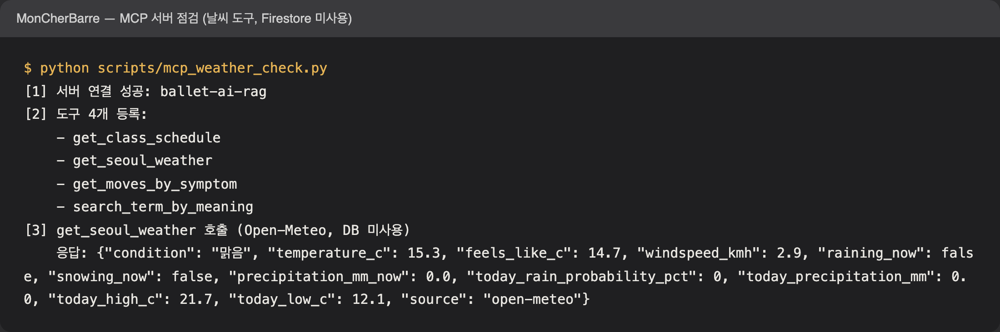

**Claude Desktop 실제 호출 화면** — 홈에서 "서울 지금 날씨 알려줘"를 보내자 Claude가 `ballet-ai-rag`의 `get_seoul_weather` 도구 사용을 요청했고(왼쪽), 허용하자 도구가 돌려준 값으로 답변했습니다(오른쪽). 답변의 출처 줄에 "Open-Meteo (서울 날씨 도구)"가 표시됩니다.

| ① 도구 사용 허용 요청 | ② 도구 결과로 만든 답변 | ③ 사용한 도구 표시 (`Get seoul weather`) |
|:---:|:---:|:---:|
| 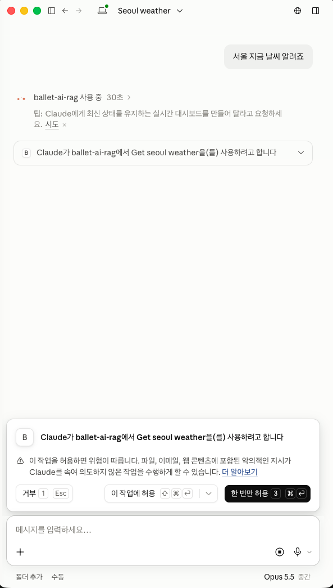 | 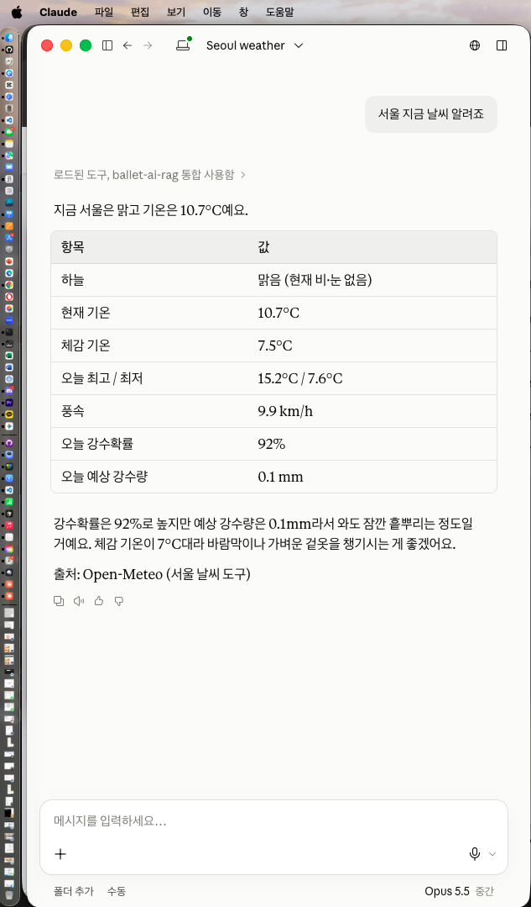 | 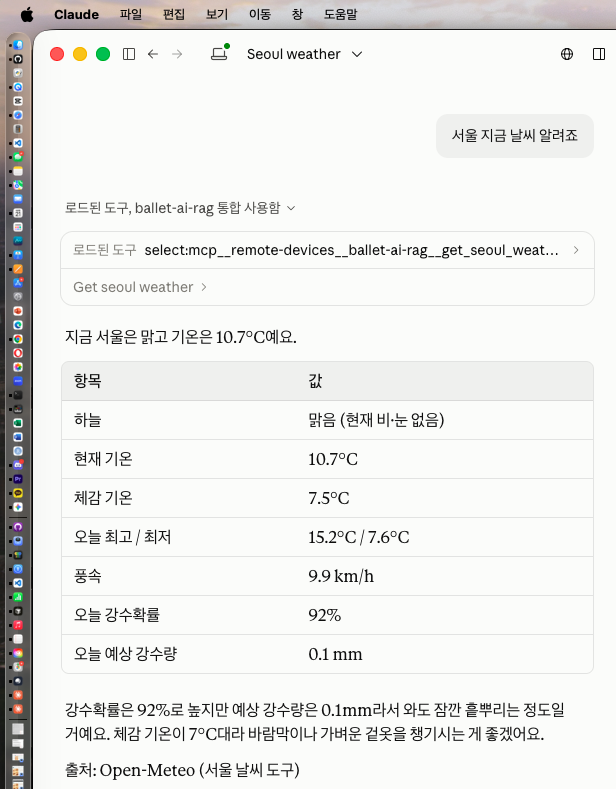 |

**MCP 프로토콜 호출 기록** — 같은 규격(stdio · JSON-RPC 2.0)으로 `초기화 → 도구 목록 → get_seoul_weather 호출`을 터미널에서 직접 실행한 결과입니다.

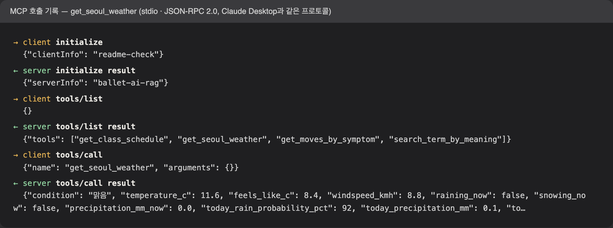

> Claude Desktop 앱의 MCP 로그(`~/Library/Logs/Claude/mcp-server-ballet-ai-rag.log`)에도 `initialize` → `tools/list` 성공이 기록되어 있습니다.

설정 예시 (`~/Library/Application Support/Claude/claude_desktop_config.json`). 프로젝트 폴더로 이동한 뒤 가상환경의 파이썬을 실행하므로, **키는 설정 파일이 아니라 프로젝트의 `.env`에서 읽습니다**(설정 파일에 키를 적지 않음):

```json
{
  "mcpServers": {
    "ballet-ai-rag": {
      "command": "/bin/bash",
      "args": ["-c", "cd /절대경로/MonCherBarre && exec venv/bin/python -m app.mcp_server"]
    }
  }
}
```

---
<br>

## 🎁 보너스 과제 충족표

### 트랙 A — AI 도구 호출(Function Calling) + 멀티채널 연동

| 요구사항 | 충족 | 구현 내용 | 위치 |
|:---|:---:|:---|:---|
| GPT가 필요할 때 내부 기능을 "도구"로 호출하도록 스키마 정의·연결 | ✅ | 도구 7개 스키마 + 실행 표, 최대 6회 반복 루프, 도구 오류도 GPT에 알려 답변 유지 | `app/services/tool_schemas.py`, `chat_service.py` |
| 동일 기능을 MCP Server 또는 GPT Actions 중 1개로 연동하고 호출 흐름 검증 | ✅ | **MCP Server**(stdio): 같은 도구를 Claude Desktop에서 호출, **날씨로 검증** | `app/mcp_server.py`, `scripts/mcp_weather_check.py` |
| README에 "어떤 근거로 어떤 도구를 호출했는지"와 흐름 정리 | ✅ | [도구 7개 호출 근거 표](#c-function-calling--도구-7개와-호출-근거), 흐름 다이어그램, [MCP 흐름](#d-mcp-server--날씨로-검증) | 이 문서 |  

<br>  


### 트랙 B — 인사이트·UX 고도화

| 요구사항 | 충족 | 구현 내용 | 위치 / 화면 |
|:---|:---:|:---|:---|
| 요약/통계 확장으로 **추가 지표 1개 이상** | ✅ | `/api/data/statistics`: **월별 평균 · 최다 연습 요일 · 최장 연속 연습일 · 총 시간**, 요약에 최근 추세(상승/하락/유지) | `data_service.get_statistics`, 데이터 탭 통계 카드 |
| 프론트 **시각화(그래프 1개 이상)** | ✅ | Chart.js 그래프 2개(월별 평균 연습 / 요일별 연습량) + 배지 3개. **기간을 정해 '분석'을 누를 때만** 그 기간의 기록을 읽어 그림 | `loadStatistics`, `06_stats_period_analysis.png` |
| **내보내기(CSV 또는 JSON)** | ✅ | CSV·JSON 둘 다 제공 (전체 기록 내려받기) | 기록 목록 아래 CSV/JSON 버튼 |
| **다크 모드 토글** | ✅ | 헤더 토글, 설정 기억, 다크 전용 팔레트(짙은 갈색 + 크림 글자) | `10_dark_mode.png` |
| 영상 임베드 등 추가 UX | ➕ | 로열발레 영상 오버레이 플레이어(호버 컨트롤), 용어 발음 mp3 | 발레 사전 탭 |  
<br>


### 🌈 추가 구현

| 기능 | 설명 |
|:---|:---|
| **루틴 음악 재생기** | 10/20/30/60분 루틴(매트·바·센터) 곡 순서 재생, 잠금 화면 컨트롤(Media Session), 화면 켜짐 유지, 앱을 벗어나도 음악 유지 |
| **발레 용어 사전 96개** | 한글 설명·IPA·프랑스어 발음 mp3·영상, 알파벳 필터, 즐겨찾기 |
| **UI 소리** | Web Audio로 합성한 피아노 음계 버튼음(켜기/끄기 칩) |
| **PWA** | 홈 화면에 추가하면 주소창 없는 앱처럼 실행, 아이콘·잠금 화면 아트워크 |
| **탭별 뒤로 가기** | 주소에 `#data` 등을 기록해 브라우저 뒤로 가기·새로고침이 탭 단위로 동작 |

---
<br>

## 🧪 Swagger UI 기능 테스트 가이드

>  **코드를 실행하지 않고** 배포 서버만으로 모든 기능을 확인 가능  
> 접속: **https://moncherbarre.onrender.com/docs** · 각 항목에서 **Try it out → Execute** 를 누르세요. 처음 한 번은 서버가 깨어나느라 최대 1분 걸릴 수 있습니다.


### 1단계. 서버·요약 (읽기 전용, 안전)

| 순서 | 엔드포인트 | 입력 | 기대 결과 (확인 포인트) |
|:---:|:---|:---|:---|
| 1 | `GET /health` | 없음 | `200` — 서버 살아 있음 |
| 2 | `GET /api/data/summary` | 없음 | `period` · `count`(370) · `metrics`(total/average/max/min) · `trend` ← **채팅 프롬프트에 주입되는 값** |
| 3 | `GET /api/data` | `start=2026-10-01`, `end=2026-10-07` | 그 기간 기록만 배열로 (기간 일수만큼만 읽음) |
| 4 | `GET /api/data/statistics` | 없음 | 월별 평균 · 최다 요일 · 연속일수 (보너스 B) |

### 2단계. 데이터 CRUD (추가 → 수정 → 삭제, 시험 데이터는 마지막에 삭제)

| 순서 | 엔드포인트 | 입력 (Request body) | 기대 결과 |
|:---:|:---|:---|:---|
| 5 | `POST /api/data` | `{"date":"2030-01-01","value":45,"memo":"README 테스트"}` | `201` + `id: "2030-01-01"` (기록이 바뀌면 요약 문서는 다음 조회 때 한 번 다시 계산됨) |
| 6 | `GET /api/data` | `start=2030-01-01`, `end=2030-01-01` | 방금 추가한 1건 |
| 7 | `PUT /api/data/{item_id}` | `item_id=2030-01-01`, `{"value":60,"memo":"수정됨"}` | `200` + 바뀐 값 |
| 8 | `DELETE /api/data/{item_id}` | `item_id=2030-01-01` | `204` |
| 9 | `POST /api/data` (잘못된 값) | `{"date":"2026-13-45","value":"칠십"}` | `422` — Pydantic 검증 |
| 10 | `PUT /api/data/{item_id}` (없는 id) | `item_id=없는id`, `{"value":1}` | `404` |

### 3단계. 대화 기록

| 순서 | 엔드포인트 | 입력 | 기대 결과 |
|:---:|:---|:---|:---|
| 11 | `POST /api/conversations` | `{"title":"테스트"}` | `201` + `id` (복사해 두기) |
| 12 | `GET /api/conversations` | `days=7` | 최근 7일 대화 목록 (`messages` 포함, 최신순) |
| 13 | `GET /api/conversations/{conv_id}` | 11번의 id | 해당 대화의 전체 `messages` (**불러오기**) |
| 14 | `DELETE /api/conversations/{conv_id}` | 11번의 id | `204`, 다시 GET하면 `404` |

### 4단계. AI 채팅과 도구 호출 (`POST /api/chat`) — 호출 근거 확인

| 순서 | 입력 (`message`) | 호출되는 도구 | 기대 결과 |
|:---:|:---|:---|:---|
| 15 | `서울 날씨 알려줘` | `get_seoul_weather` | 날씨·기온·풍속·**비/눈 여부·강수확률** 표 + 요약 |
| 16 | `오늘 수업 있어?` | `get_class_schedule` | 수·토 수업 시간표 기준 답변 |
| 17 | `발목이 아파요. 오늘 뭘 피하고 뭘 하면 좋아?` | `get_moves_by_symptom` (상태를 말했으므로 `save_note`도 호출될 수 있음) | 피할 동작 표 + 강화 운동 표(준비물·시간·방법·주의·▶/🌐 링크) |
| 18 | `허리를 뒤로 젖히는 동작 이름이 뭐죠?` | `search_term_by_meaning` | 가까운 용어 후보와 한글 설명·영상 링크 |
| 19 | `10분 루틴 시작해요` | `get_routine` (+ 필요 시 `get_move_links`) | **매트 구간만**, 곡 3개의 시간(4:00·4:00·2:00)과 곡마다 이완·바닥 운동 2개(햄스트링 스트레칭·복근·장요근·스파인 코렉터·밴드), R/지구본 링크 |
| 20 | `60분 루틴 시작해요` | `get_routine` | 매트·바·센터 구간 모두, 매트는 바닥 운동만·바는 바 동작·센터는 회전·점프까지 |
| 21 | 위 질문마다 응답의 `conversation_id`로 `GET /api/conversations/{id}` | — | 질문·답변이 **자동 저장**되어 있음 (미션 4-7의 4번) |  
<br>

> ⚠️ 채팅은 실제로 대화가 저장됩니다. 테스트 후 14번처럼 `DELETE /api/conversations/{id}`로 지워 주세요.  
> 화면(Vercel)에서는 루틴 버튼(10/20/30/60분)을 누르면 19·20번과 같은 흐름이 자동으로 실행됩니다.  
<br>

### 5단계. 사전·즐겨찾기

| 순서 | 엔드포인트 | 입력 | 기대 결과 |
|:---:|:---|:---|:---|
| 22 | `GET /api/moves/favorites` | 없음 | 저장한 즐겨찾기 목록 |

---
<br>
<br>


## 🧠 나를 아는 비서: 

### "일반 챗봇과 무엇이 다른가?"   
>- 대화방을 지워도 ③이 남아 **이전 추천을 기억**합니다. 새 대화방에서 루틴을 물어도 앞서 말한 발목 통증을 알고 추천동작으로 제외합니다.
>- 추천은 "먼저 거르고(통증 부위의 피할 동작) → 루틴 구성에 맞춰 고르는" 순서이며, 루틴의 **곡·시간은 사용자가 만든 그대로** ,  동작과 주의점만 그날 상태에 맞춰 고릅니다.  

| 층 | 내용 | 바뀌는 빈도 | 저장 위치 | 채팅 때 읽기 |
|:---:|:---|:---:|:---|:---:|
| ① 고정·상태 | 아픈 부위와 날짜, 컨디션, 일정 변경 | 가끔 | `assistant/memory.notes` (`save_note` 도구로 저장) | 문서 1장 |
| ② 최근 활동 | 최근 14일 연습량, 자주 찾은 용어, 본 영상, 주로 한 루틴, 즐겨찾기 | 매일 | 기록 요약 + `assistant/memory.counts` | 문서 1장 + 최대 14건 |
| ③ 대화 요지 | 최근 질문·답변 12개 + 오래된 대화를 GPT가 요약해 이어 붙인 글 | 매 대화 | `assistant/memory.recent / history_summary` | 같은 문서 |
| ④ 지식 | 96개 용어, 증상표, 강화 운동, 루틴 구성, 곡별 동작 | 거의 안 바뀜 | **파일** (저장소) | **0** |

 
<bf> 
<br>


### 채팅 표의 링크 아이콘 읽는 법

| 아이콘 | 의미 | 대상 |
|:---:|:---|:---|
| 🟡 **R**  | **로열발레단 영상** (Royal Ballet and Opera) | 발레 사전에 연결된 29개 용어 |
| 🌐 | 유튜브 링크 (웹) | 모든 동작. 운동은 저장해 둔 운동 영상으로, 영상이 없으면 유튜브 검색으로 연결 |

>>동작은 표의 "동작과 영상" 칸에 **한 줄에 하나씩** 적히고, 아이콘은 그 동작 이름 바로 뒤에 붙습니다. 표와 글자, 아이콘은 화면 폭에 맞춰 함께 커지고 줄어듭니다.  

<br>
<br>


### 루틴 구간별 동작 규칙

| 구간 | 쓰는 동작 | 예 |
|:---|:---|:---|
| **매트** (마루 바닥) | 몸을 이완하고 코어를 쓰는 **바닥 운동만** (곡마다 2개씩 순서대로) | 햄스트링 스트레칭, 복근(코어), 장요근, 스파인 코렉터, 밴드 운동 |
| **바** | 바에서 하는 동작 | 플리에, 탕뒤, 데가제, 퐁뒤, 데블로페, 아라베스크 |
| **센터** | 제한 없음 | 회전, 점프, 아다지오 |

>이 규칙은 `frontend/data/area_moves.json`  파일이고, **재생기와 채팅이 같은 파일**을 읽습니다.

---
<br>

## 📉 Firestore 읽기 절감 설계

무료 플랜의 **하루 읽기 5만 건**을 넘기지 않도록, "바뀌지 않는 것은 파일에, 자주 바뀌는 것은 문서 1장에, 한 번 읽은 것은 다시 읽지 않기"를 원칙으로 했습니다.

| 동작 | 이전 | 현재 |
|:---|:---:|:---:|
| 앱 접속 (요약 카드) | 기록 전체 약 365건 | **문서 1건** (`meta/summary`) |
| 데이터 탭 열기 | 365건 | **최근 14일만** (약 14건) |
| 통계 | 접속할 때마다 | 기간을 정해 **'분석'을 누를 때만**, 이미 읽은 기간은 0건 |
| 대화 탭 열기 | 대화 118개 전체 | **최근 7일** 방만, 기간 조회 시 그 기간만 |
| 채팅 한 번 | 약 370건 | **약 2~3건** |
| 용어 의미 검색 | 25건 | **0건** (색인 파일) |
| 루틴 버튼 | 채팅 호출마다 ≈370건 | 도구가 파일에서 읽어 **0건** |

| 기법 | 설명 |
|:---|:---|
| 요약 문서 | 요약을 `meta/summary` 문서 1장에 저장, 기록을 바꾸면 지우고 다음에 한 번 재계산 |
| 기간 조회 | `GET /api/data?start=&end=`, `GET /api/conversations?start=&end=` — 요청한 기간만 읽음 |
| 브라우저 보관함 | 읽어 온 기간을 `localStorage`에 쌓고 **안 읽은 구간만** 서버에 요청 (`makeRangeStore`) |
| 서버 메모리 보관 | 같은 조회는 6시간 재사용, 쓰기 때만 즉시 비움 |
| 파일 기반 지식 | 사전·증상표·강화 운동·루틴·색인은 저장소 파일 → Firestore 읽기 0 |
| 지연 로딩 | 데이터·대화·즐겨찾기 탭은 **처음 열 때만** 불러옴 |
| 성공 후 저장 | 새 대화는 GPT 답변이 성공한 뒤에만 생성(빈 대화방 방지), 질문·답변을 한 번에 저장 |

---
<br>

## 📱 iPad 최적화

| 영역 | 적용 내용 |
|:---|:---|
| **가로 화면** | 왼쪽(대표 사진·루틴 재생기)과 오른쪽(채팅)이 **각자 스크롤**, 페이지는 고정. 입력창은 채팅 카드 맨 아래, 읽는 동안에는 숨겨졌다가 아래쪽을 터치하면 다시 나타남 |
| **세로 화면** | 입력창을 화면 아래에 고정, 읽는 중에는 숨김 |
| **유동 레이아웃** | 날짜 칸·버튼·메뉴·표·글자가 화면 폭에 맞춰 함께 줄어듦(320px까지 확인), 기간 조회 같은 버튼은 줄바꿈 없이 같은 줄 유지 |
| **홈 화면 앱(PWA)** | `manifest.webmanifest`, apple-touch-icon, 상태바·노치 안전 영역(safe-area) 처리 |
| **음악** | 잠금 화면 컨트롤(Media Session), 화면 켜짐 유지(Wake Lock), 앱을 벗어나도 음악 유지(백그라운드 재생 스위치) |
| **터치** | 길게 눌러 툴팁, 탭 선택 시 반짝임, 호버가 없는 환경에서도 눌림 반응 |
| **글자·표** | 채팅 글자는 더 많은 내용을 담도록 조정, 표는 좁으면 가로 스크롤, 영상 링크는 ▶/🌐 버튼 |
| **이미지** | 대표 사진 6장을 iPad용으로 용량 축소, 접속할 때 하나가 정해지고 새로고침하면 바뀜 |

---
<br>

## API 목록 · Firestore 컬렉션

### API

| 메서드 | 경로 | 설명 |
|:---|:---|:---|
| GET | `/health` | 서버 상태 |
| GET | `/api/data` | 연습 기록 (`start`, `end` 로 기간 조회, 없으면 전체) |
| POST | `/api/data` | 기록 추가 (201) |
| PUT | `/api/data/{id}` | 기록 수정 (없으면 404) |
| DELETE | `/api/data/{id}` | 기록 삭제 (204) |
| GET | `/api/data/summary` | 기간·개수·평균/최대/최소·추세 |
| GET | `/api/data/statistics` | 월별 평균·최다 요일·연속일수 |
| POST | `/api/conversations` | 대화 생성 (201) |
| GET | `/api/conversations` | 대화 목록 (`days`, `start`, `end`) |
| GET | `/api/conversations/{id}` | 대화 불러오기 (전체 messages) |
| DELETE | `/api/conversations/{id}` | 대화 삭제 (204) |
| POST | `/api/chat` | AI 채팅 (`message`, 선택 `conversation_id`·`activity`·`weather`) |
| GET | `/api/moves` | 발레 용어 API |
| GET/POST/DELETE | `/api/moves/favorites` | 즐겨찾기 |

### Firestore

| 컬렉션/문서 | 용도 | 주요 필드 |
|:---|:---|:---|
| `data` (370) | 연습 기록 — 미션 필수 | `date`, `value`(분), `memo` (문서 id = 날짜) |
| `conversations` | 대화 기록 — 미션 필수 | `title`, `messages[]`, `updated_at` |
| `meta/summary` | 요약 문서 | `period`, `count`, `metrics`, `trend` |
| `assistant/memory` | 비서 메모 | `notes`, `recent`, `history_summary`, `counts`, `favorites` |
| `favorites` | 즐겨찾기 | 용어, 영상, 저장 시각 |
| `class_schedule` (2) | 수업 시간표 | `day`, `start`, `end` |
| `symptom_map` (4) · `routine_templates` (4) · `moves` (96) | 시드 데이터(현재 채팅은 같은 내용의 파일을 읽음) | — |

---
<br>

## ⚙️ Environment Setup

```bash
# 1. 저장소 복제
git clone https://github.com/OZ-Codessey/MonCherBarre.git
cd MonCherBarre

# 2. 가상환경 생성 및 활성화 (macOS/Linux, Python 3.10+)
python3 -m venv venv
source venv/bin/activate

# 3. 의존성 설치
pip install -r requirements.txt
```

> ## 🔐 Environment Variables

보안을 위해 모든 키는 소스 코드에 넣지 않고 **환경 변수**(로컬 `.env`, Render 대시보드)로 관리합니다.

| 구분 | 변수명 | 상세 설명 | 비고 |
|:---|:---|:---|:---|
| **필수** | `OPENAI_API_KEY` | GPT 채팅·임베딩 호출용 키 | [OpenAI Platform](https://platform.openai.com/) |
| **필수** | `FIREBASE_SERVICE_ACCOUNT_JSON` | Firebase 서비스 계정 키. 로컬은 **JSON 파일 경로**, Render는 **JSON 내용 전체** | Firebase 콘솔 → 프로젝트 설정 → 서비스 계정 |
| 선택 | `OPENAI_MODEL` | 채팅 모델 (기본 `gpt-5-mini`) | — |
| 선택 | `ALLOWED_ORIGINS` | CORS 허용 도메인, 쉼표로 구분 (비우면 전체 허용) | 예: `https://mon-cher-barre.vercel.app` |
| 프론트 | `API_BASE_URL` | 프론트가 호출할 백엔드 주소 | `frontend/config.js` (로컬 `http://localhost:8000`, 배포 `https://moncherbarre.onrender.com`) |

프로젝트 루트에 `.env` 파일을 만들어 아래처럼 채웁니다(`.gitignore`로 GitHub에 올라가지 않음).

```env
OPENAI_API_KEY=sk-...
FIREBASE_SERVICE_ACCOUNT_JSON=./서비스계정키.json
OPENAI_MODEL=gpt-5-mini
ALLOWED_ORIGINS=http://localhost:5500,https://mon-cher-barre.vercel.app
```

<br>

# 🌐 How to Run

### 1. 데이터 준비 (최초 1회)
```bash
python scripts/seed_data.py               # 연습 기록 365건을 data 컬렉션에
python scripts/seed_extra_collections.py  # 증상표·수업 시간표·루틴 구성표
# 용어 색인 파일은 저장소에 포함되어 있습니다. 사전 내용을 고쳤을 때만:
python scripts/build_embeddings.py        # moves_96.json → app/data/moves_embeddings.json
```

### 2. 백엔드 실행
```bash
uvicorn app.main:app --reload
# → http://localhost:8000/docs 에서 Swagger 확인
```

### 3. 프론트엔드 실행 (다른 터미널)
```bash
# frontend/config.js 의 API_BASE_URL 을 http://localhost:8000 으로 바꾼 뒤
python3 -m http.server 5500 -d frontend
# → http://localhost:5500
```

### 4. MCP 서버 점검
```bash
python scripts/mcp_weather_check.py   # 서버 연결 → 도구 4개 → 날씨 호출
```

<br>

## ☁️ Production Deployment

**백엔드 — Render**
1. GitHub 저장소를 Render Web Service로 연결 (`render.yaml`이 빌드·실행 명령을 정의)
   - Build: `pip install -r requirements.txt` · Start: `uvicorn app.main:app --host 0.0.0.0 --port $PORT` · Health check: `/health`
2. Environment에 `OPENAI_API_KEY`, `FIREBASE_SERVICE_ACCOUNT_JSON`(JSON **내용 전체**), `ALLOWED_ORIGINS` 입력
3. 배포 후 `/docs` 접속 확인

**프론트엔드 — Vercel**
1. 같은 저장소를 Vercel에 연결 (`vercel.json`: 빌드 없음, 출력 폴더 `frontend`, 첫 페이지는 항상 새로 받도록 no-cache)
2. `frontend/config.js`의 `API_BASE_URL`을 Render 주소로 설정
3. `main` 브랜치에 push하면 자동 배포

**CORS·환경 변수가 필요한 이유**
- 프론트(vercel.app)와 백엔드(onrender.com)는 **도메인이 달라** 브라우저가 기본으로 요청을 막습니다. 백엔드가 허용할 도메인을 `ALLOWED_ORIGINS`로 명시해야 통신됩니다.
- 키를 코드에 쓰면 저장소와 함께 유출됩니다. 환경(로컬/Render)별로 값만 바꿔 쓰려면 환경 변수로 분리해야 합니다.

<br>

### 👮🏼‍♂️ Compliance & Security Notice
```
1. 모든 API Key와 서비스 계정 키는 환경 변수로만 관리하며 저장소와 클라이언트 번들에 노출되지 않습니다.
2. 입력 값은 Pydantic으로 검증하고, 없는 리소스는 404, 잘못된 값은 422로 응답합니다.
3. 의료 서비스가 아닙니다. 강화 운동·스트레칭 안내는 일반적인 정보이며, 통증이 심하거나 오래가면 전문가 상담을 권합니다.
```

<br><br>


<br>

## 제한 사항 

| 항목 | 내용 |
|:---|:---|
| Render 콜드 스타트 | 무료 플랜은 잠들었다 깨는 첫 요청이 최대 1분 걸림 (화면 안내 문구 제공)- UptimeRobot으로대응 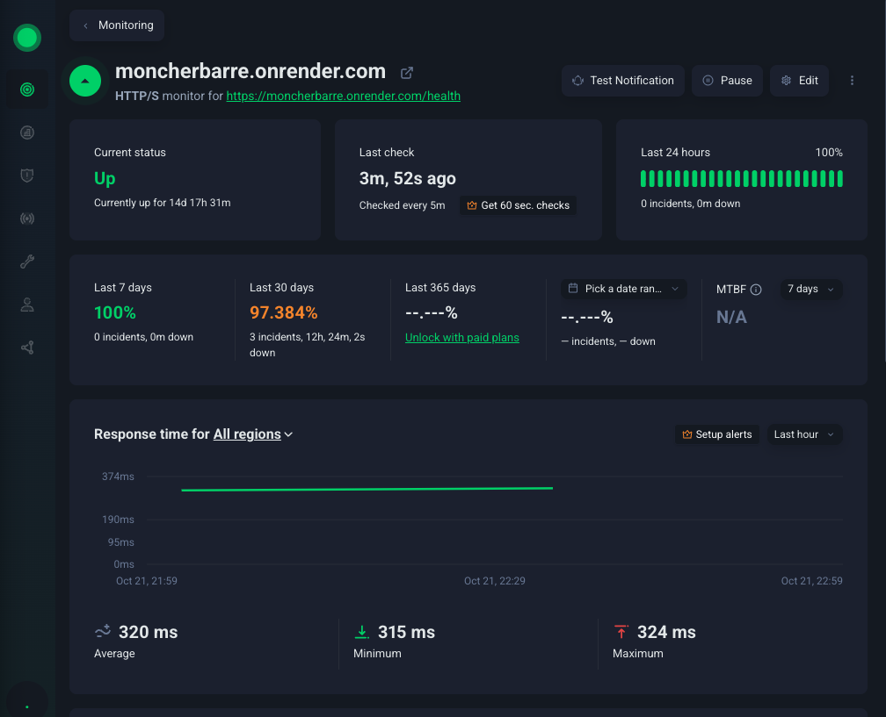 |
| 날씨 서비스 | Open-Meteo가 가끔 503을 내므로 재시도 → wttr.in 대체 → 브라우저가 받아 둔 값 순으로 사용 |
| 용어 의미 검색 | 사전 설명이 방향·위치 중심이라 묘사가 모호하면 정확한 용어가 1위가 아닐 수 있어, 후보 6개를 GPT가 설명을 보고 고름 |
| 강화 운동·스트레칭 안내 | 일반적인 내용이며 의료 조언이 아님 |
| 호버 소리 | 브라우저 정책상 페이지를 한 번 클릭·터치한 뒤부터 소리가 남 (iPad는 첫 터치부터) |
| MCP 도구 | 현재 4개(시간표·날씨·증상별 동작·의미 검색)를 노출- claude desktop app에서 날씨로 시험 함 |

<br>

## Development Timeline

| 날짜 | 단계 | 주요 내용 |
|:---|:---|:---|
| 09-27 ~ 09-28 | **Day 1~2** 데이터·백엔드·RAG | 연습 기록 365일 업로드, FastAPI CRUD·요약, 대화 API, `/api/chat` 컨텍스트 주입, RAG 도구 4개, Function Calling 연결, MCP 서버 |
| 09-29 | **Day 3** 배포·보너스 B | Render·Vercel 배포 설정, 통계 API·그래프·CSV/JSON 내보내기, 수정 기능, 콜드 스타트 안내 |
| 10-01 ~ 10-03 | 검색·사전·캐싱 | 검색/필터/페이지, 발레 사전과 유튜브 연동, localStorage 캐싱으로 읽기 절감 |
| 10-04 | 재생기·iPad | 루틴 음악 재생기, 알파벳 사전, 로열발레 영상, **iPad 최적화**, PWA 아이콘·잠금 화면 |
| 10-05 | 디자인·날씨·소리 | 날씨 칩, UI 소리, 유리 카드·팔레트, 다크 모드 보정, 입력창·좌우 칸 레이아웃 |
| 10-06 | 맞춤 비서·읽기 절감 | 비서 메모, 요약 문서·기간 조회, 용어 96개 색인, 루틴 도구(`get_routine`), 강화 운동 하드코딩 |
| 10-07 | 다듬기 | 재생기와 일치하는 루틴 답변, 유동 레이아웃, 즐겨찾기 삭제 수정, 탭 뒤로 가기 |
| 10-08 ~ 10-09 | 마무리 | 날씨 도구 안정화(재시도·대체 서비스), 매트=이완·바닥 운동, 화면 폭에 맞춘 표·재생 컨트롤, R·지구본 링크 아이콘, README·스크린샷 |   


<br>
<br>

<details>
<summary><b>🌲 Directory Structure (클릭하여 펼치기)</b></summary>

```text
MonCherBarre/
├── app/                              # FastAPI 백엔드
│   ├── main.py                       # 앱 시작점: CORS, 라우터 등록, /health
│   ├── mcp_server.py                 # MCP 서버 (도구 4개, stdio)
│   ├── core/                         # config.py(환경 변수), firebase.py(Firestore 연결)
│   ├── routers/                      # HTTP 창구
│   │   ├── data.py                   #   연습 기록 CRUD · summary · statistics
│   │   ├── conversations.py          #   대화 저장·목록·불러오기·삭제
│   │   ├── chat.py                   #   POST /api/chat
│   │   └── moves.py                  #   발레 용어·즐겨찾기
│   ├── schemas/                      # Pydantic 요청·응답 모델 (data, conversation, chat)
│   ├── services/                     # 실제 로직
│   │   ├── chat_service.py           #   컨텍스트 주입 + Function Calling 루프 + 저장
│   │   ├── tool_schemas.py           #   도구 7개 스키마 + 실행 표
│   │   ├── rag_tools.py              #   도구 구현 (GPT·MCP 공용)
│   │   ├── moves_local.py            #   사전·증상표·강화 운동·루틴을 파일에서 읽기
│   │   ├── memory_service.py         #   비서 메모(assistant/memory)
│   │   ├── data_service.py           #   기록 CRUD, 요약 문서, 기간 조회, 서버 캐시
│   │   ├── conversation_service.py   #   대화 CRUD, 기간 조회, 성공 후 저장
│   │   ├── embedding_model.py        #   임베딩 모델 이름(색인·질문이 같은 모델)
│   │   └── moves_service.py · youtube_service.py
│   └── data/                         # 서버가 읽는 파일 지식
│       ├── exercises.json            #   강화 운동 11개 + 스트레칭 6개 (준비물·시간·방법·주의·영상)
│       └── moves_embeddings.json     #   용어 96개 의미 색인 (1536차원)
│
├── frontend/                         # Vercel 배포 대상 (정적)
│   ├── index.html · config.js · manifest.webmanifest
│   ├── css/style.css · js/app.js
│   ├── data/                         # moves_96.json · routines.json · music_mapping.json · symptom_map.json · area_moves.json(구간별 동작 규칙)
│   ├── music/                        # 루틴 음악 7곡
│   ├── studio/ · icons/ · assets/    # 대표 사진 6장 · 앱 아이콘 · 이미지
│
├── scripts/                          # 시드·색인·점검 스크립트
│   ├── seed_data.py · seed_extra_collections.py · seed_moves.py
│   ├── build_embeddings.py           # 용어 색인 생성
│   ├── migrate_conversations.py      # 빈 대화방 정리(1회성)
│   └── mcp_weather_check.py          # MCP 서버 점검
│
├── data/                             # 원본 CSV (연습 기록 365일, ABT 사전 96개)
├── records/                          # 스크린샷·실행 증거
├── works/                            # 작업 일지 (작업별 기록)
├── render.yaml · vercel.json · requirements.txt
├── MISSION.md · README.md
```
</details>

## 🔍 Commit Log

<details>
<summary><b>📜 Commit Log 전체 108개 (클릭하여 펼치기)</b></summary>

> 총 **108개** 커밋 (RAG 관련은 메시지 앞에 `[RAG-데이터]` `[RAG-검색]` `[RAG-연결]` 단계 태그)

| No. | Commit Hash | 날짜 | Commit Message | 기능 및 주요 작업 내역 |
| :---: | :---: | :---: | :--- | :--- |
| **1** | `3b4ca8b` | 2026-09-24 | Initial commit | GitHub 저장소 최초 생성 |
| **2** | `d0875b5` | 2026-09-27 | Initial commit: gitignore | .gitignore 초기 설정 (비밀 키 파일 제외) |
| **3** | `bc50bd5` | 2026-09-28 | Add requirements.txt for backend dependencies | 백엔드 의존성(requirements.txt) 정리 |
| **4** | `25d2045` | 2026-09-28 | Add seed script and source CSV for the data collection | 연습 기록 365일 CSV와 Firestore `data` 업로드 스크립트 |
| **5** | `d355e92` | 2026-09-28 | [RAG-데이터] Add moves seed script for the ABT ballet dictionary | **[RAG-데이터]** ABT 발레 용어 96개를 Firestore에 올리고 핵심 25개를 임베딩하는 스크립트 |
| **6** | `fcec200` | 2026-09-28 | Add FastAPI app skeleton with data CRUD and summary endpoints | FastAPI 뼈대: 데이터 CRUD 4개 + `/summary` 엔드포인트, Pydantic 검증, CORS |
| **7** | `a1a30d4` | 2026-09-28 | Add frontend shell with hero/splash images and dark mode | 프론트엔드 첫 틀: 스플래시·대표 사진·다크 모드 |
| **8** | `2a78152` | 2026-09-28 | Add symptom_map, class_schedule, routine_templates seed data | 증상표(symptom_map)·수업 시간표·루틴 구성표 시드 데이터 |
| **9** | `efb4d74` | 2026-09-28 | Add conversations API (POST/GET/DELETE) | 대화 기록 API: 저장·목록·삭제 (`/api/conversations`) |
| **10** | `8074e31` | 2026-09-28 | Add /api/chat with context injection | `/api/chat`: 데이터 요약을 시스템 프롬프트에 넣는 **컨텍스트 주입** |
| **11** | `b4ae0b3` | 2026-09-28 | [RAG-검색] Add 4 pure-Python RAG tool functions | **[RAG-검색]** 순수 파이썬 도구 4개(시간표·날씨·증상별 동작·의미 검색) 작성 |
| **12** | `0581b81` | 2026-09-28 | [RAG-연결] Wire RAG tools into /api/chat via Function Calling | **[RAG-연결]** GPT Function Calling으로 도구 4개를 `/api/chat`에 연결 |
| **13** | `9d362be` | 2026-09-28 | Add data management & conversation history UI with tabs | 데이터 관리·대화 기록 화면과 탭 UI |
| **14** | `b31588b` | 2026-09-28 | Add MCP server exposing RAG tools to Claude Desktop | **[MCP]** Claude Desktop에서 같은 도구를 쓰는 MCP 서버 추가 |
| **15** | `d1256d5` | 2026-09-28 | Add /health endpoint for deployment health checks | 배포 상태 확인용 `/health` 엔드포인트 |
| **16** | `33e115f` | 2026-09-29 | Add strengthening exercises video links to symptom_map | 부상별 강화 운동 유튜브 링크를 symptom_map에 추가 |
| **17** | `a420b5f` | 2026-09-29 | Configure MCP server for Claude Desktop | Claude Desktop 연동 설정 |
| **18** | `79e2755` | 2026-09-29 | Merge remote-tracking branch 'origin/main' | 원격 저장소와 병합 |
| **19** | `084abbf` | 2026-09-29 | Remove README (will be added later) | README 임시 제거(나중에 다시 작성) |
| **20** | `2a51129` | 2026-09-29 | Add deployment config for Render and Vercel | Render·Vercel 배포 설정(render.yaml, vercel.json) |
| **21** | `0cd4280` | 2026-09-29 | Fix service name, health endpoint path, and backend URL | 서비스 이름·헬스 체크 경로·백엔드 주소 수정 |
| **22** | `1df5828` | 2026-09-29 | Fix weather API error handling to prevent chat failures | 날씨 API 실패가 채팅 전체를 멈추지 않도록 예외 처리 |
| **23** | `b3a6632` | 2026-09-29 | Trigger Vercel deployment | Vercel 재배포 트리거 |
| **24** | `9aa89a8` | 2026-09-29 | Add /api/data/statistics endpoint | **[보너스 B]** `/api/data/statistics` (월별 평균·최다 요일·연속일수) |
| **25** | `5a668bf` | 2026-09-29 | Add monthly practice chart and statistics badges to data tab | **[보너스 B]** 월별 연습 그래프와 통계 배지 |
| **26** | `f8d9fa8` | 2026-09-29 | Add CSV and JSON export buttons to data tab | **[보너스 B]** CSV·JSON 내보내기 버튼 |
| **27** | `97b4e74` | 2026-09-29 | Add inline edit (수정) feature to data records | 연습 기록 인라인 수정(수정 버튼) |
| **28** | `d330b67` | 2026-09-29 | Force Vercel redeploy | Vercel 재배포 트리거 |
| **29** | `fb79bd2` | 2026-10-01 | Make frontend StaticFiles mount conditional on ENVIRONMENT | 프론트 정적 서빙을 환경 변수로 선택 가능하게 변경 |
| **30** | `b99843d` | 2026-10-01 | Use date as Firestore document ID in create_data | 기록의 Firestore 문서 ID를 날짜로 지정 |
| **31** | `694fa38` | 2026-10-01 | Add search, filter, pagination and auto-sort to data tab | 검색·필터·페이지·자동 정렬 |
| **32** | `c26fef3` | 2026-10-01 | Add cold-start notice for Render free tier sleep delay | Render 무료 플랜 **콜드 스타트 안내 문구** |
| **33** | `fb73086` | 2026-10-02 | Change health check endpoint from /ballet to /health | 헬스 체크 경로를 `/health`로 변경 |
| **34** | `08b19a0` | 2026-10-02 | Remove frontend StaticFiles serving — Render API only | 백엔드는 API만 제공하도록 정적 서빙 제거 |
| **35** | `be5668a` | 2026-10-02 | Fix data tab search/filter issues | 데이터 탭 검색·필터 오류 수정 |
| **36** | `5a8933e` | 2026-10-02 | Fix API endpoint to use Render deployment environment | 프론트가 Render 배포 주소를 쓰도록 수정 |
| **37** | `97903ec` | 2026-10-02 | [RAG-데이터] Add ballet dictionary API and YouTube integration | **[RAG-데이터]** 발레 사전 API와 유튜브 영상 연동 |
| **38** | `653bbfb` | 2026-10-02 | Add ballet dictionary frontend and supporting backend updates | 발레 사전 프론트엔드 |
| **39** | `80d9e5a` | 2026-10-02 | Trigger Vercel redeploy | Vercel 재배포 트리거 |
| **40** | `9848b77` | 2026-10-02 | Trigger auto-deploy after reconnecting GitHub | GitHub 재연결 후 자동 배포 확인 |
| **41** | `c450a2a` | 2026-10-02 | Implement localStorage caching for ballet dictionary | 발레 사전 localStorage 캐싱 |
| **42** | `38ae736` | 2026-10-02 | Add YouTube direct link button to ballet dictionary | 사전에 유튜브 바로가기 버튼 |
| **43** | `fe2834e` | 2026-10-02 | [성능최적화] localStorage 캐싱으로 Firestore 할당량 99% 절감 | **[성능최적화]** localStorage 캐싱으로 Firestore 할당량 99% 절감 |
| **44** | `0bbae8d` | 2026-10-03 | [UI 개선] 대문사진 랜덤 선택 및 studio 폴더 통합 | 대표 사진 랜덤 선택, studio 폴더 통합 |
| **45** | `abcb2f7` | 2026-10-04 | Implement advanced music player with full playback controls | 루틴 음악 재생기(재생·이전·다음·±4초·진행바) |
| **46** | `9e514ed` | 2026-10-04 | Implement 365-day data caching with essential graphs and refined UI | 365일 기록 캐싱과 핵심 그래프, UI 정리 |
| **47** | `38d0d6a` | 2026-10-04 | Fix API endpoint path for practice data caching | 기록 캐싱 API 경로 수정 |
| **48** | `7d82715` | 2026-10-04 | Fix music playback, graphs, favorites; add Korean translations, verified videos, pronunciation audio | 음악 재생·그래프·즐겨찾기 수정, 한글 설명·영상·발음 오디오 추가 |
| **49** | `db7aad0` | 2026-10-04 | Revamp routine player and dictionary detail UI; fix pronunciation audio URLs | 루틴 재생기·사전 상세 화면 개편, 발음 오디오 주소 수정 |
| **50** | `d9353a8` | 2026-10-04 | Add alphabet-first dictionary, Royal Ballet zoom player, iPad-optimized layout | 알파벳 우선 사전, 로열발레 영상 확대 플레이어, **iPad 최적화** 레이아웃 |
| **51** | `a6d3315` | 2026-10-04 | Add app icon and manifest, fold long lists to 7 items, table-style chat answers | 앱 아이콘·매니페스트(PWA), 긴 목록 7개 접기, 표 형식 채팅 답변 |
| **52** | `91d781d` | 2026-10-04 | Finalize ballerina arabesque icon; set tab title to 'MonCherBarre ballet agent' | 아라베스크 발레리나 아이콘 확정, 탭 제목 설정 |
| **53** | `dae8af1` | 2026-10-04 | Polish hero/charts/favicons; make routine switching stop previous audio | 히어로·차트·파비콘 다듬기, 루틴 전환 시 이전 음악 정지 |
| **54** | `f31a88a` | 2026-10-04 | Add lock-screen media info and artwork, refresh icons, replace stats emoji | 잠금 화면 미디어 정보·아트워크, 아이콘 갱신 |
| **55** | `49fd870` | 2026-10-05 | Rotate six resized studio images; shrink images for iPad | 대표 사진 6장 순환, iPad용으로 용량 축소 |
| **56** | `10879a8` | 2026-10-05 | Add Seoul weather chip and text-style tab navigation | **서울 날씨 칩**과 텍스트형 탭 메뉴 |
| **57** | `a50e475` | 2026-10-05 | Shrink header brand, align header with page content, widen tab spacing | 헤더 로고 축소·정렬, 탭 간격 확대 |
| **58** | `b461418` | 2026-10-05 | Polish routine/player/chat design and add visible sending feedback | 루틴·재생기·채팅 디자인 다듬기, 전송 중 표시 |
| **59** | `6734042` | 2026-10-05 | Unify typography: Jost + Pretendard light text, fluid sizes, brown-gold text color, light text-style tabs | 타이포그래피 통일(Jost + Pretendard), 유동 글자 크기 |
| **60** | `002c9f8` | 2026-10-05 | Replace the Korean send label with a one-line SEND button | 한 줄 SEND 버튼 |
| **61** | `47eb783` | 2026-10-05 | Restyle page and card titles as small gold bracket labels | 페이지·카드 제목을 작은 금색 괄호 라벨로 |
| **62** | `12ac3a2` | 2026-10-05 | Redesign dark mode toggle | 다크 모드 토글 새 디자인 |
| **63** | `bcddb62` | 2026-10-05 | Make the weather chip clearer with condition colors | 날씨 칩 색으로 날씨 구분 |
| **64** | `6da2333` | 2026-10-05 | Dictionary: pale 3D alphabet plates, ALL toggle, larger term list | 사전 알파벳 3D 플레이트, ALL 토글 |
| **65** | `7dc48ca` | 2026-10-05 | Add UI sounds with an on/off switch | **UI 소리**(Web Audio)와 켜기/끄기 칩 |
| **66** | `f827129` | 2026-10-05 | Royal Ballet video: compact action row and hover controls player | 로열발레 영상: 간결한 행동줄과 호버 컨트롤 |
| **67** | `d7a1367` | 2026-10-05 | Stats: smaller gray-gold chart text and compact badges | 통계 글자·배지 크기 정리 |
| **68** | `1b05ddd` | 2026-10-05 | Data page: side-by-side add/search cards, aligned rows, unified buttons | 데이터 탭: 추가/검색 카드 나란히, 정렬, 버튼 통일 |
| **69** | `2a18f4d` | 2026-10-05 | Memo search: live partial match with highlighted text, memo only | 메모 검색: 부분 일치 + 일치 부분 음영 |
| **70** | `461861f` | 2026-10-05 | Keep the chat input and send button fixed at the bottom on portrait screens | 세로 화면에서 채팅 입력창을 화면 아래에 고정 |
| **71** | `bf2ebbe` | 2026-10-05 | Avoid overlap with the iPad status bar and make tab text clearer | iPad 상태바 겹침 방지, 탭 글자 선명하게 |
| **72** | `83b9aef` | 2026-10-05 | Give the sticky tab bar a frosted translucent background | 스티키 탭 바를 반투명 유리로 |
| **73** | `b481ee5` | 2026-10-05 | Keep the chat input fixed at the bottom on landscape screens too | 가로 화면에서도 채팅 입력창 고정 |
| **74** | `307b3b7` | 2026-10-05 | Keep music playing when leaving the app; add a background-play switch | 앱을 벗어나도 음악 유지, 백그라운드 재생 스위치 |
| **75** | `39c4b54` | 2026-10-05 | Align dictionary and favorites cards to the same top and height | 사전·즐겨찾기 카드 높이 정렬 |
| **76** | `9132065` | 2026-10-05 | Center the now-playing header and remove italics app-wide (except weather text) | 재생 헤더 가운데 정렬, 기울임체 제거 |
| **77** | `07e4f93` | 2026-10-05 | Soften the alphabet button letter color | 알파벳 글자색 부드럽게 |
| **78** | `33a649c` | 2026-10-05 | Add small Korean tooltips to icon buttons | 아이콘 버튼 한글 툴팁 |
| **79** | `d9180ff` | 2026-10-05 | Zone plates: gray-gold Au milieu, balanced size, skewer-style divider lines | 구역 이름표(바닥·바·센터) 정리 |
| **80** | `210e6dd` | 2026-10-05 | Stats: half-size centered summary badges | 통계 배지 절반 크기·가운데 정렬 |
| **81** | `6556df1` | 2026-10-05 | Add a soft gray gradient to the top header | 상단 헤더에 부드러운 회색 그라데이션 |
| **82** | `1f56eee` | 2026-10-05 | Lower UI sound volume: button sounds to about 30%, piano notes to 30% | 버튼음·피아노음 볼륨 30%로 낮춤 |
| **83** | `70794ca` | 2026-10-05 | Make the header brand a home button | 제목(로고)을 홈 버튼으로 |
| **84** | `bd3f63e` | 2026-10-05 | Polish the light theme: glass cards, cream inputs, alphabet gradient, no home tooltip | 라이트 테마 다듬기: 유리 카드·크림 입력·알파벳 그라데이션 |
| **85** | `0c000cd` | 2026-10-05 | Fix dark mode text contrast | 다크 모드 글자 대비 보정 |
| **86** | `fe7daba` | 2026-10-05 | Refine color palette: dusty rose, bronze gold, warm brown dark mode | **색 팔레트 정리**: 더스티 로즈·브론즈·짙은 갈색 다크 모드 |
| **87** | `8b5a405` | 2026-10-05 | Fix chat input bar leaving the screen on glass card | 유리 카드 때문에 입력창이 화면 밖으로 밀리던 문제 수정 |
| **88** | `a8da604` | 2026-10-05 | Fix iPad layout: separate pane scrolling, in-card input bar, tighter player list | iPad 가로: 좌우 칸 따로 스크롤, 입력창을 카드 안으로, 곡 목록 간격 |
| **89** | `fee8431` | 2026-10-05 | Show strengthening exercise tables with video link buttons in chat | 부상 질문 시 강화 운동 표와 ▶/🌐 링크 버튼 |
| **90** | `31a2e7d` | 2026-10-06 | [RAG-검색] Search all 96 terms locally with embeddings, hard-code strengthening exercises, richer weather tool | **[RAG-검색]** 용어 96개 로컬 임베딩 색인, 강화 운동 하드코딩, 날씨 도구에 비·눈 |
| **91** | `06feef2` | 2026-10-06 | Add assistant memory document and personalised chat prompt with video links | **비서 메모**(assistant/memory) 문서와 맞춤 프롬프트, 영상 링크 열 |
| **92** | `95b2737` | 2026-10-06 | Cut Firestore reads: summary document, range queries, 7-day conversation list | 읽기 절감: 요약 문서·기간 조회·대화 7일 목록 |
| **93** | `b11ba8f` | 2026-10-06 | Frontend: range-based stores, period stats, conversation search, input bar hiding, centered close buttons | 기간별 보관함, 기간 통계, 대화 검색, 입력창 숨김 |
| **94** | `c61df46` | 2026-10-06 | Add get_routine tool, mat-section exercises and routine-specific chat answers | **`get_routine` 도구**: 사용자의 루틴 구성·곡별 동작으로 답변, 매트 구간 운동 |
| **95** | `73cdfce` | 2026-10-06 | Make stats cards responsive, fold conversation lookups, add in-field date clear buttons and hover feedback | 통계 반응형, 대화 접기, 날짜 칸 안 지우기(↺), 호버 반응 |
| **96** | `cc15d58` | 2026-10-07 | Match routine answers to the player: exact track times, moves from the player list | 루틴 답변을 재생기와 일치: 곡 시간 그대로, 동작은 재생기 목록에서 선택 |
| **97** | `7cbae8e` | 2026-10-07 | Fix favorites delete, fluid layout, slimmer buttons, front-most tooltips, tab history | 즐겨찾기 삭제 버그, 유동 레이아웃, 날씬한 버튼, 툴팁 맨 앞, 탭 뒤로 가기 |
| **98** | `54faae4` | 2026-10-07 | Align the two panes, return to the first screen from the brand, free reading space above the input bar | 좌우 카드 정렬, 제목 클릭 시 첫 화면, 입력창 여백 축소 |
| **99** | `2aaa68f` | 2026-10-09 | Make the weather tool resilient with retry, wttr.in fallback and the browser's snapshot, and compact routine tables | 날씨 도구 안정화: 재시도, wttr.in 대체, 브라우저 값 사용, 루틴 표 한 개로 |
| **100** | `55bd3c6` | 2026-10-09 | Reduce chat text to 80%, send the weather snapshot, tidy the data and dictionary titles | 채팅 글자 80%, 날씨 값 전달, 표 줄바꿈, 데이터·사전 탭 제목 정리 |
| **101** | `9722468` | 2026-10-09 | Use floor stretching and core exercises for the mat section, and re-read the assistant memory every five minutes | 매트 구간은 이완·바닥 운동만(햄스트링·복근·장요근·스파인 코렉터·밴드), 비서 메모 5분마다 다시 읽기 |
| **102** | `026ff71` | 2026-10-09 | Scale chat tables, player controls and layout with screen width; unify card and page titles | 채팅 표·재생 컨트롤·레이아웃이 화면 폭에 맞춰 조절, 카드·페이지 제목 통일 |
| **103** | `f1e1b05` | 2026-10-09 | Floor exercises link their stored video through the globe, not the Royal Ballet R | 매트 운동 영상은 로열발레단이 아니므로 R이 아니라 지구본으로 연결 |
| **104** | `86743ca` | 2026-10-09 | Draw the R (Royal Ballet video, gold) and globe (web link, pink) as slim white glyphs centred in discs of equal size, one move per line | 동작마다 한 줄, R(골드·로열발레단 영상)과 지구본(분홍·웹)을 글자 크기 원 안에 가운데 정렬 |
| **105** | `e7cc296` | 2026-10-21 | [MCP] Rewrite the MCP server for mcp 2.2.0 and add a weather check script | **[MCP]** mcp 2.2.0 방식으로 도구를 다시 정의, 날씨 점검 스크립트 추가, Claude Desktop에서 `get_seoul_weather` 호출 확인 |

| **106** | `b724974` | 2026-10-21 | Validate input ranges and escape user text before rendering | 입력 검증(연습 시간 0~1440분·메모 200자·제목 100자·질문 2000자)과 화면에 넣기 전 이스케이프 |
| **107** | `1b2f8be` | 2026-10-21 | Add helper scripts, music mapping notes and Royal Ballet match data | 보조 스크립트, 음악 매핑 노트, 로열발레 매칭 데이터 |
| **108** | `4a369ee` | 2026-10-21 | Add README screenshots and the environment variable template | README 이미지 22장(`records/readme`, `records/mcp`)과 환경 변수 템플릿 `.env.example` |
</details>

<br>
<br>

```
🩰 중요
Mon Cher Barre는 의료·치료용 서비스가 아닙니다. 발레 연습을 기록하고, 연습 상황을 기억하는 AI 비서와 루틴·동작·용어를 쉽게 찾아 쓰도록 돕는 연습 보조 서비스입니다.
```
